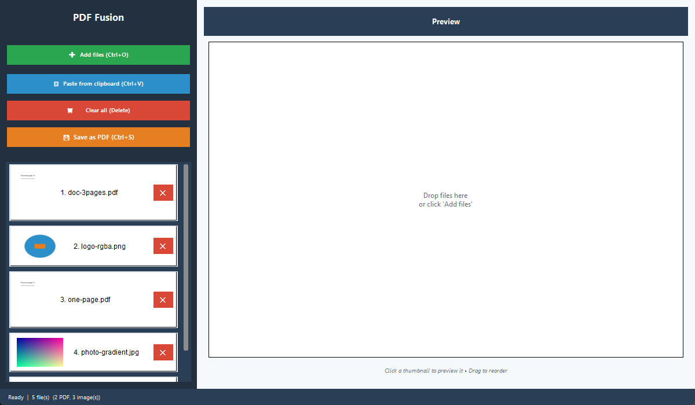
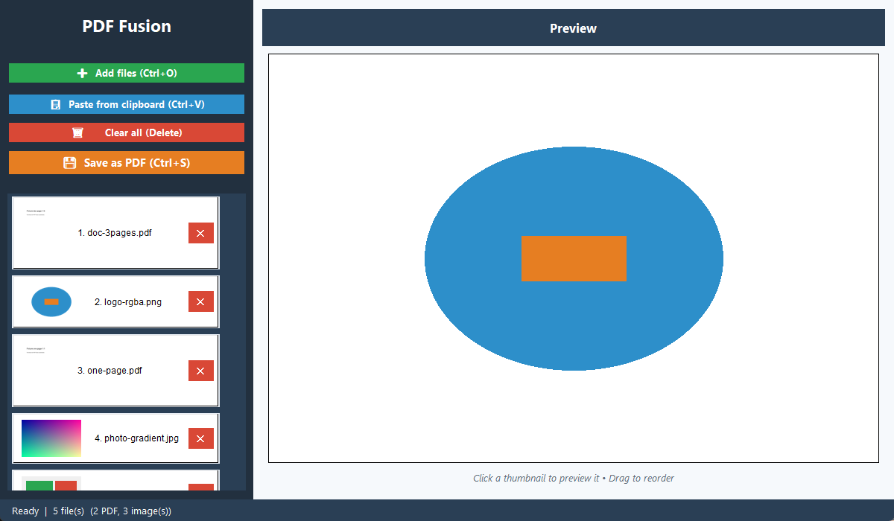

# 📄 PDF Fusion

A desktop app for Windows that merges PDFs and images into a single PDF document.

Everything runs locally on your machine. No files are uploaded anywhere.


## ✨ Features

- **📁 Supported input formats:** PDF, JPG, JPEG and PNG
- **🖱️ Drag & drop:** drop files onto the window (requires `tkinterdnd2`)
- **🔄 Reordering:** drag thumbnails to change the order of the output
- **👁️ Preview:** click a thumbnail to see a larger preview
- **📋 Clipboard:** paste an image straight from the clipboard
- **🎨 Two-panel layout:** thumbnails on the left, preview on the right

## 📸 Screenshots





## 🚀 Installation

### Requirements

- Python 3.10 or newer (the code uses `X | None` type annotations)
- pip

### Step 1: Clone the repository

```bash
git clone https://github.com/randheimer/PDF-Fusion.git
cd PDF-Fusion
```

### Step 2: Install the dependencies

```bash
pip install -r requirements.txt
```

| Package | Required | Purpose |
|---------|----------|---------|
| `Pillow` | yes | Image handling and PDF page creation for images |
| `PyPDF2` | yes | Reading and merging PDF pages |
| `PyMuPDF` (1.24.3 or newer) | optional | PDF thumbnails and previews. Older releases only provide the `fitz` module name, which this version does not import. |
| `tkinterdnd2` | optional | Drag & drop from Explorer |
| `pycryptodome` | optional | Needed by PyPDF2 for AES-encrypted PDFs |

### Step 3: Start the application

```bash
python main.py
```

## 💻 Usage

The buttons and their shortcuts:

| Button (label in the app) | Shortcut | Action |
|---------------------------|----------|--------|
| ➕ Add files | Ctrl+O | Add PDF and image files |
| 📋 Paste from clipboard | Ctrl+V | Add an image from the clipboard |
| 🗑️ Clear all | Delete | Remove all files (asks for confirmation) |
| 💾 Save as PDF | Ctrl+S | Export everything as one PDF |

1. **Add files:** click "Add files", or drag files into the window.
2. **Change the order:** drag thumbnails up or down. The export follows the order shown.
3. **Preview:** click a thumbnail. A PDF shows its first page; an image is shown in full. Previews are scaled to fit, to at most 800 px.
4. **Remove a file:** click the red ✕ on its thumbnail.
5. **Paste an image:** copy an image, then click "Paste from clipboard".
6. **Export:** click "Save as PDF" and choose the output file. Every page of every PDF is kept. Each image becomes one page.

Images with transparency are placed on a white background.

## 🛠️ Technical Details

### Project layout

```
PDF-Fusion/
├── main.py              # The application (single file)
├── README.md            # This file
├── CONTRIBUTING.md      # Contribution guidelines
├── LICENSE              # MIT license
└── docs/screenshots/    # Screenshots used in this README
```

### Main component

- **`PDFFusionApp`** (`main.py`): the Tkinter application.
  - Builds the window and the UI.
  - Manages the file list, drag & drop reordering and removal.
  - Creates thumbnails and previews.
  - Exports the result with PyPDF2 and Pillow.

### Supported formats

| Format | Input | Output | Preview |
|--------|-------|--------|---------|
| PDF    | ✅ | ✅ all pages | ✅ with PyMuPDF |
| JPG    | ✅ | ✅ one page per image | ✅ |
| JPEG   | ✅ | ✅ one page per image | ✅ |
| PNG    | ✅ | ✅ one page per image | ✅ |

The output is always a single PDF. Images are saved as pages at a resolution of 100 DPI.

### Defaults

- Window size: 1200×700 px, minimum 800×500 px
- Thumbnail size: 80×80 px
- Maximum preview size: 800 px

## 🐛 Troubleshooting

### PDF thumbnails show a placeholder, and clicking a PDF only shows its page count
PyMuPDF is missing or older than 1.24.3. Install a current version:

```bash
pip install --upgrade PyMuPDF
```

### Drag & drop does not work
Install `tkinterdnd2`:

```bash
pip install tkinterdnd2
```

### An encrypted PDF cannot be exported
PDFs that use AES encryption need `pycryptodome`:

```bash
pip install pycryptodome
```

PDFs that require a password to open cannot be merged, because the app does not ask for one.

### Images do not look right in the PDF
RGBA, LA and palette (P) images are converted to RGB on a white background. Check the source image if the result looks wrong.

## 🤝 Contributing

Contributions are welcome. See [CONTRIBUTING.md](CONTRIBUTING.md) for how to report bugs, suggest features and submit pull requests.

## 📝 Roadmap

- [ ] Support for more image formats (TIFF, BMP, GIF)
- [ ] Edit individual PDF pages
- [ ] Add watermarks
- [ ] Batch processing
- [ ] Command-line interface
- [ ] Portable .exe version
- [ ] Multilingual interface
- [ ] Light/dark mode toggle

## 📄 License

This project is licensed under the MIT License. See the [LICENSE](LICENSE) file for details.

## 👤 Author

Made with ❤️ for the open-source community.

## 🙏 Acknowledgements

- [Pillow](https://python-pillow.org/): Python Imaging Library
- [PyPDF2](https://pypdf2.readthedocs.io/): PDF toolkit
- [PyMuPDF](https://pymupdf.readthedocs.io/): PDF rendering
- [tkinterdnd2](https://github.com/pmgagne/tkinterdnd2): drag & drop support

## 📞 Support

If you have questions or run into problems:
- [Open an issue](https://github.com/randheimer/PDF-Fusion/issues)
- Contact the maintainer via GitHub

---

**Note:** This project is under active development. Feedback and suggestions are welcome.
